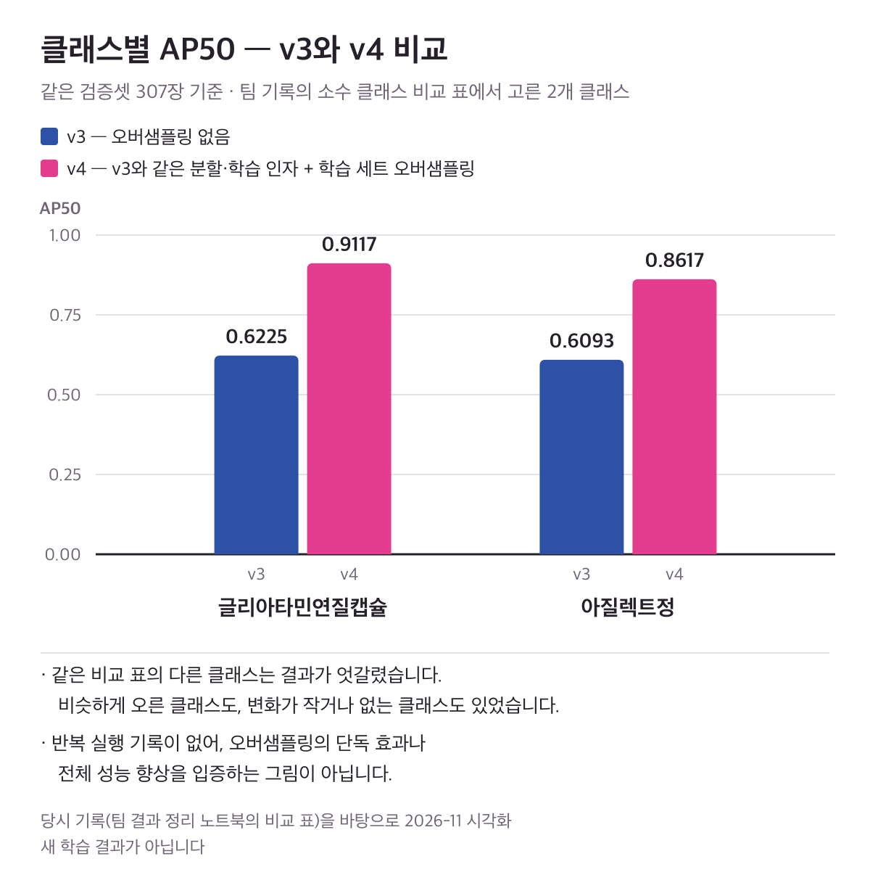

# 💊 경구약제 이미지 객체 검출

<p align="center">
  
  
  
  
  
</p>

<p align="center">
  <b>코드잇 부트캠프 초급 프로젝트 · 4인 팀 프로젝트</b><br/>
  알약 사진에서 약제의 위치와 종류를 찾는 객체 검출 — 클래스 불균형을 어떻게 다루고 결과를 어떻게 판단했는지를 중심으로 정리했습니다
</p>

---

## 📌 한눈에 보기

- **문제** — 경구약제 이미지에서 약제의 위치와 종류를 찾되, 클래스별 어노테이션 수가 **최대 73.4배**까지 차이 나는 불균형을 다뤄야 했습니다
- **내 역할** — 데이터 분석 · 전처리 · 불균형 보완 · 분할 · v3 학습 설정 ([`notebooks/`](./notebooks))
- **팀원 역할** — 모델 구조 설계 · 튜닝, 이후 버전 실험과 최종 제출. 최종 제출본은 제 노트북 산출물이 아닙니다
- **확인한 결과** — 같은 검증셋 307장에서 두 소수 클래스의 AP50이 v3보다 v4에서 높게 기록됐습니다 (아래 그림). 단독 효과로 단정하지 않습니다

---

## 📊 확인한 결과

<p align="center">
  
</p>

- **v3 → v4 클래스별 AP50** (같은 검증셋 307장)
  - 글리아타민연질캡슐 0.6225 → 0.9117
  - 아질렉트정 0.6093 → 0.8617
- **v4**는 v3와 같은 분할 · 학습 인자에 **학습 세트 오버샘플링만 더한 구성**입니다.
- 이 두 클래스는 팀 기록의 소수 클래스 비교 표에서 고른 사례입니다. 같은 표의 다른 클래스는 결과가 엇갈렸습니다 — 비슷하게 오른 클래스도, 변화가 작거나 없는 클래스도 있었습니다.
- 반복 실행 기록이 없어, 이 비교는 **오버샘플링의 단독 효과나 전체 성능 향상을 입증하지 않습니다.**
- 참고로, 제가 맡은 v3 구성의 Kaggle Public 기록은 **0.99109**입니다. 팀의 최종 제출 점수가 아니며, 대회 테스트 이미지에 대한 Kaggle 지표라 검증셋 AP50과 이어 읽지 않습니다.

> 그림은 당시 기록(팀 결과 정리 노트북의 비교 표)을 바탕으로 **2026-11에 다시 그린 시각화**입니다. 당시 노트북의 원본 그림이나 새 학습 결과가 아닙니다.
> AP50 비교 표와 v3 Public 기록은 팀 최종 노트북 [`oral_medication_final.ipynb`](./oral_medication_final.ipynb)의 `6. 전체 실험 결과 정리` 아래 `6-1. 버전별 성능 비교` · `6-2. 소수 클래스 AP50 버전별 비교` 절에서 확인할 수 있습니다. 73.4배와 307장은 `notebooks/`의 두 노트북 출력에 있습니다.

---

## 🔄 처리 흐름 (내가 맡은 부분)

1. **데이터 분석** — 클래스 분포 · 불균형 확인
2. **전처리** — 비정상 BBox 제거 · 클래스 ID 재매핑
3. **학습 · 검증 분할** — 다중 라벨 층화 분할
4. **불균형 보완 (v4에서만 적용)** — 학습 세트만 이미지 복제. v3에는 이 단계가 없습니다
5. **학습 설정 (v3 · v4 공통)** — YOLO 형식 변환 · YOLOv8m. 색상(HSV) · 회전 · 반전 증강은 끄고, mosaic · mixup은 사용

모델 구조 설계 · 튜닝은 이 흐름의 다음 단계가 아니라 팀원이 맡은 별도 역할이며, 최종 제출도 팀원 작업입니다.

---

## 💡 핵심 판단

**1. 다중 라벨 층화 분할을 선택했다**
한 이미지에 여러 약제가 함께 찍혀 있어, 이미지를 단위로 나누면 여러 클래스가 함께 움직입니다. 무작위 분할에서는 적게 등장하는 클래스가 검증셋에 거의 들어가지 않거나 한쪽으로 쏠릴 수 있어, 이미지마다 들어 있는 클래스를 다중 라벨로 표시하고 `MultilabelStratifiedShuffleSplit`으로 모든 클래스의 비율을 함께 맞췄습니다. 분할 뒤에는 학습 · 검증 양쪽에 모든 클래스가 들어 있는지 출력으로 확인했습니다.

**2. 복제한 이미지 안의 클래스를 모두 함께 센다 (v4)**
어노테이션이 기준보다 적은 클래스를 골라, 그 클래스가 들어 있는 학습 이미지를 어노테이션째 복제했습니다. 이미지를 복제하면 같은 이미지의 다른 클래스도 함께 늘어나므로, 클래스별 카운터를 하나로 공유해 복제할 때마다 이미지 안의 모든 클래스 수를 함께 올리고, 대상 클래스가 기준에 닿으면 멈추게 했습니다. 다만 이 방식도 과잉 복제를 완전히 막지는 못해, 다른 클래스를 채우려고 복제한 이미지에 함께 있던 클래스가 기준을 넘어 늘어난 경우가 있었습니다. 검증셋은 복제하지 않았습니다.

---

## ⚠️ 한계

- Public 점수와 검증셋 AP50은 평가 데이터와 지표가 달라 서로 비교하지 않습니다
- AP50 향상을 오버샘플링의 효과로 단정하지 않습니다 — 반복 실행 기록이 없고, 클래스별 결과가 엇갈렸습니다
- 최종 제출에 쓰인 구성은 이 README에서 다루지 않습니다 (팀원 작업)
- 오버샘플링은 이미지를 그대로 복제하는 방식이라, 새로운 모양의 데이터를 늘리지는 못합니다

---

## 🗂️ 코드 둘러보기

- [`notebooks/YOLOv8m_best.ipynb`](./notebooks/YOLOv8m_best.ipynb) — **v3** (내 담당): 데이터 분석 · 전처리 · 분할 · 학습 설정 · 추론
- [`notebooks/oral_medication.ipynb`](./notebooks/oral_medication.ipynb) — **v4** (내 담당): v3 흐름 + 학습 세트 오버샘플링
- [`oral_medication_final.ipynb`](./oral_medication_final.ipynb) — 팀 최종 노트북 (팀 공동 정리본, 제 단독 작업 아님)
- [`reports/20260330_tomas_yolo8m_v3.pdf`](./reports/20260330_tomas_yolo8m_v3.pdf) — YOLOv8m v3 실험 문서
- [`docs/figures/ap50-v3-v4.png`](./docs/figures/ap50-v3-v4.png) — 위 그림 (2026-11 시각화)

두 노트북은 같은 순서로 구성돼 있어, 아래 제목으로 찾으면 됩니다.

| 보고 싶은 것 | 노트북 안의 제목 |
|---|---|
| 클래스 분포 · 불균형 확인 | `3. 클래스 분포 분석` |
| 비정상 BBox 제거 · 클래스 ID 재매핑 | `5. 데이터 전처리` |
| 다중 라벨 층화 분할 | `5-4. train/val 분리` |
| 학습 세트 오버샘플링 (v4만) | `oral_medication.ipynb`의 `5-4` 바로 뒤 오버샘플링 셀 |
| YOLO 형식 변환 · 학습 설정 | `6. DataLoader 구성` · `6-2. 모델 학습 코드` |

---

## 🚀 실행 환경

- **Google Colab** (GPU) 기준으로 작성됐습니다
- 데이터는 Google Drive에 두고 마운트해서 씁니다 — 노트북의 경로 변수(`/content/drive/MyDrive/...`)를 본인 위치로 바꿔 주세요
- 대회 데이터는 이 저장소에 포함돼 있지 않습니다

```bash
pip install ultralytics iterative-stratification opencv-python pandas matplotlib
```

---

## 🔧 기술 스택

| 영역 | 기술 |
|------|------|
| 모델 | Ultralytics YOLOv8m |
| 프레임워크 | PyTorch · TorchVision |
| 데이터 분할 | iterative-stratification (`MultilabelStratifiedShuffleSplit`) |
| 데이터 처리 | pandas · NumPy · OpenCV · Pillow |
| 시각화 | Matplotlib |
| 환경 | Google Colab · Google Drive |

---

<p align="center">
  <sub>
    포트폴리오 상세: <a href="https://minseong-code-lab.vercel.app/projects/oral-medication-detection">minseong-code-lab.vercel.app</a> ·
    팀 자료: <a href="https://colab.research.google.com/drive/10YRtRRwaORnLEYSEgRa3amK1wvelAG6Q#scrollTo=OHmaR0SA5o9c">보고서 (Colab)</a> ·
    <a href="https://docs.google.com/presentation/d/1it5B1HVkXf2Zfq6S1dIB4PEeXuRfl3eq/edit?slide=id.p1#slide=id.p1">발표자료</a> ·
    <a href="https://docs.google.com/spreadsheets/d/1O0zfyg_hiWu-L02N85qwJBho2GCq3n_pO2jacypseG8/edit?gid=1590775431#gid=1590775431">협업일지</a><br/>
    MIT License · 자세한 내용은 <a href="./LICENSE">LICENSE</a>
  </sub>
</p>
