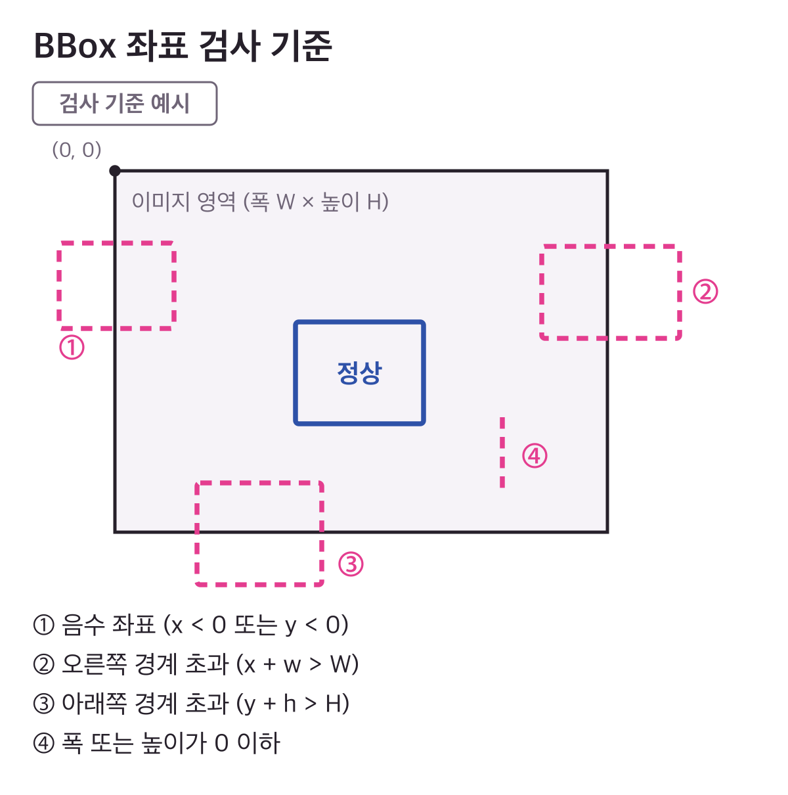
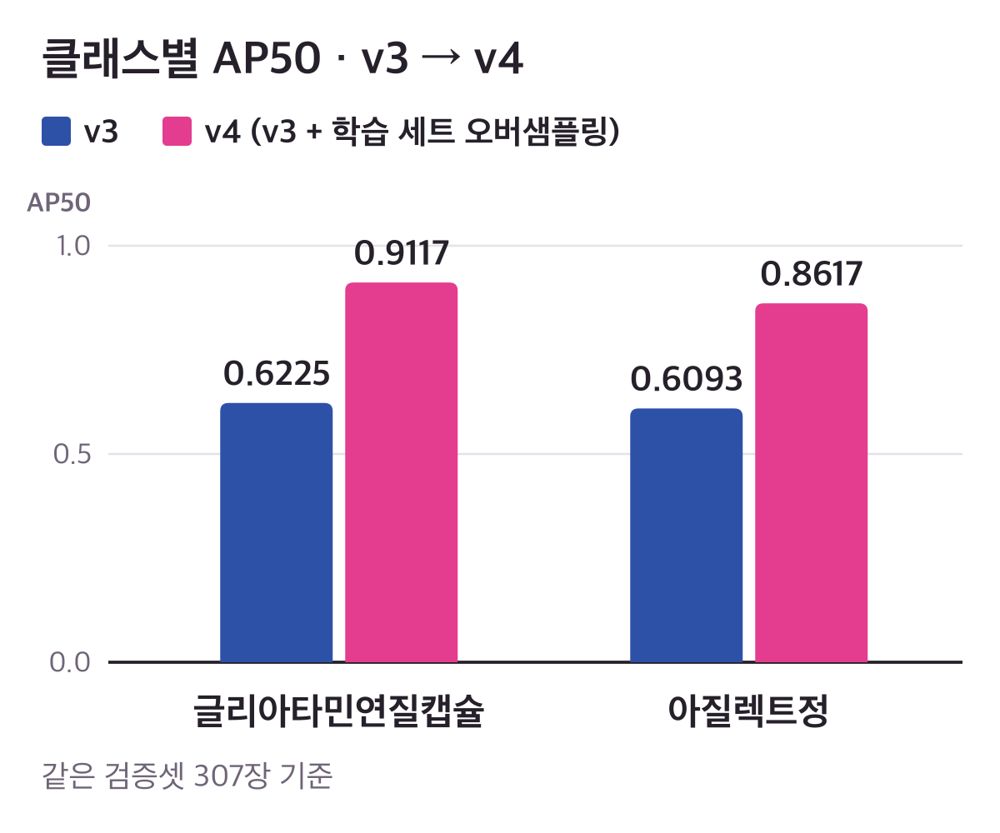

# 💊 경구약제 이미지 객체 검출

<p align="center">
  
  
  
  
  
</p>

<p align="center">
  <b>코드잇 부트캠프 초급 프로젝트 · 4인 팀 프로젝트</b><br/>
  알약 사진에서 약제의 위치와 종류를 찾는 객체 검출 — 데이터 담당으로 라벨 품질 · 클래스 불균형 · 학습/검증 구성을 다룬 기록
</p>

---

## 📌 문제와 내 역할

약제의 위치와 종류를 찾는 검출 모델을 학습하려면, 좌표가 잘못된 객체 위치 라벨을 걸러내고 클래스별 어노테이션 수가 **최대 73.4배**까지 차이 나는 불균형을 다뤄야 했습니다.

4인 팀에서 **데이터 분석과 전처리를 담당했습니다.** 잘못된 객체 위치 라벨을 정제하고, 클래스 불균형을 보완하며 학습 · 검증 데이터를 구성했습니다.

- **내 담당** ([`notebooks/`](./notebooks)) — 데이터 분석, 라벨 좌표 정제와 클래스 ID 재매핑, 학습 · 검증 분할, 불균형 보완(v4), 전처리 결과 검증, v3 학습 설정(YOLO 형식 변환 · YOLOv8m, 색상 · 회전 · 반전 증강은 끄고 mosaic · mixup은 사용)
- **팀원 담당** — 모델 구조 설계 · 튜닝, 이후 버전 실험과 최종 제출. 최종 제출본은 제 노트북 산출물이 아닙니다

| 단계 | 내용 | 적용 |
|---|---|---|
| 데이터 분석 | 클래스 분포 · 불균형 확인 | v3 · v4 |
| 라벨 좌표 정제 | BBox 좌표 검사 · 오류 라벨 제거 · 클래스 ID 재매핑 | v3 · v4 |
| 학습 · 검증 분할 | 다중 라벨 층화 분할 | v3 · v4 |
| 불균형 보완 | 학습 세트만 이미지 복제 | **v4만** |
| 최종 검증 | 좌표 재검사 · 클래스별 학습 · 검증 비율 확인 | v3 · v4 |
| 학습 설정 | YOLO 형식 변환 · YOLOv8m | v3 · v4 공통 |

---

## 🧹 데이터 품질 정제

객체 위치 라벨(BBox, `x · y · w · h`)을 이미지 크기와 대조해 좌표 오류를 검사했습니다. 이상해 보이는 이미지를 통계적으로 골라낸 것이 아니라, **라벨 좌표가 이미지 안에 제대로 놓였는지**를 본 작업입니다.

<p align="center">
  
</p>
<p align="center"><sub>검사 기준 예시 — 실제 데이터나 좌표를 옮긴 그림이 아닙니다</sub></p>

- **검사** — 음수 좌표, 폭 · 높이 0 이하, 오른쪽 · 아래쪽 이미지 경계 초과를 어노테이션마다 확인
- **처리** — 실제로 나온 오류는 이미지 영역 밖으로 벗어난 어노테이션이었고, **그 어노테이션만 제거**했습니다. 이미지는 남겼고, 잘못된 좌표를 추정해 고치지 않았습니다
- **재매핑** — 오류 라벨을 제거한 뒤, 원본 클래스 ID를 연속 번호로 재매핑해 학습용 형식에 맞췄습니다
- **재검사** — 분할(v4는 오버샘플링까지)이 끝난 뒤 최종 검증에서 같은 기준으로 좌표를 다시 검사했습니다

---

## ⚖️ 클래스 불균형 대응

클래스별 어노테이션 수가 **최대 73.4배**까지 차이 났습니다. 적게 등장하는 클래스는 학습에서 볼 기회가 적고, 검증셋에서도 몇 개만 남을 수 있습니다. 이를 완전히 해소한 것이 아니라, 다음 방식으로 보완하고 확인했습니다.

- **학습 세트에만 복제 오버샘플링 (v4에서만 적용)** — 분할이 끝난 뒤, 어노테이션이 기준보다 적은 클래스가 들어 있는 학습 이미지를 어노테이션째 복제했습니다. v3에는 이 단계가 없습니다
- **공유 카운터** — 이미지를 복제하면 함께 찍힌 다른 클래스도 늘어나므로, 복제할 때마다 이미지 안의 모든 클래스 수를 하나의 카운터로 함께 올리고, 대상 클래스가 기준에 닿으면 멈췄습니다
- **한계** — 그래도 다른 클래스를 보충하려고 복제한 이미지에 함께 있던 클래스는 기준을 넘어 늘어날 수 있었습니다. 또 이미지를 그대로 복제하는 방식이라 새로운 모양의 데이터를 늘리지는 못합니다
- **검증셋은 복제하지 않았습니다** — 원래 분할 그대로 두었습니다

---

## 🔀 학습 · 검증 분할과 확인

한 이미지에 여러 약제가 함께 찍혀 있어, 이미지 단위로 나누면 여러 클래스가 함께 움직입니다. 무작위 분할에서는 적게 등장하는 클래스가 검증셋에 거의 들어가지 않거나 한쪽으로 쏠릴 수 있어, 이미지마다 들어 있는 클래스를 다중 라벨로 표시하고 `MultilabelStratifiedShuffleSplit`으로 모든 클래스의 비율을 함께 맞췄습니다.

분할과 보완이 끝난 뒤 최종 검증에서 다음을 출력으로 확인했습니다.

- 학습 · 검증 양쪽에 모든 클래스가 들어 있는지
- 클래스마다 검증셋 비율이 목표에서 크게 벗어나지 않는지
- BBox 좌표가 모두 유효한지 (위 기준으로 재검사)

---

## 📊 팀 실험에서 관찰한 결과

<p align="center">
  
</p>
<p align="center"><sub>같은 검증셋 307장 기준 · 팀 비교 표에서 선별한 두 클래스 · v3: 오버샘플링 없음, v4: v3 + 학습 세트 오버샘플링 · 출처: 팀 실험 기록</sub></p>

- 글리아타민연질캡슐 **0.6225 → 0.9117**, 아질렉트정 **0.6093 → 0.8617** (AP50, v3 → v4)
- 같은 표의 다른 클래스는 변화 폭이 달랐습니다. 반복 실행 기록이 없어, 이 차이를 오버샘플링 하나의 효과로 단정하지 않습니다
- 제가 맡은 v3 구성의 **Kaggle Public 기록은 0.99109**입니다. 팀의 최종 제출 점수가 아니며, 대회 테스트 이미지에 대한 지표라 검증셋 AP50과 이어 읽지 않습니다
- 근거: 팀 최종 노트북 [`oral_medication_final.ipynb`](./oral_medication_final.ipynb)의 `6-1. 버전별 성능 비교` · `6-2. 소수 클래스 AP50 버전별 비교`

---

## 🗂️ 코드와 실행 안내

- [`notebooks/oral_medication.ipynb`](./notebooks/oral_medication.ipynb) — **v4** (내 담당): v3 흐름 + 학습 세트 오버샘플링
- [`notebooks/YOLOv8m_best.ipynb`](./notebooks/YOLOv8m_best.ipynb) — **v3** (내 담당): 데이터 분석 · 전처리 · 분할 · 학습 설정 · 추론
- [`oral_medication_final.ipynb`](./oral_medication_final.ipynb) — 팀 최종 노트북 (팀 공동 정리본, 제 단독 작업 아님)
- [`reports/20260330_tomas_yolo8m_v3.pdf`](./reports/20260330_tomas_yolo8m_v3.pdf) — YOLOv8m v3 실험 문서
- [`docs/figures/`](./docs/figures) — 이 README의 그림

두 노트북은 같은 순서로 구성돼 있어, 아래 제목으로 찾으면 됩니다.

| 보고 싶은 것 | 노트북 안의 제목 |
|---|---|
| 클래스 분포 · 불균형 확인 | `3. 클래스 분포 분석` |
| BBox 좌표 검사 · 오류 라벨 제거 · 클래스 ID 재매핑 | `5. 데이터 전처리` |
| 다중 라벨 층화 분할 | `5-4. train/val 분리` |
| 학습 세트 오버샘플링 (v4만) | `oral_medication.ipynb`의 `5-4` 바로 뒤 오버샘플링 셀 |
| 좌표 재검사 · 클래스별 비율 확인 | `5-6. 전처리 결과 검증` |
| YOLO 형식 변환 · 학습 설정 | `6. DataLoader 구성` · `6-2. 모델 학습 코드` |

**실행 환경**

- **Google Colab** (GPU) 기준으로 작성됐습니다
- 데이터는 Google Drive에 두고 마운트해서 씁니다 — 노트북의 경로 변수(`/content/drive/MyDrive/...`)를 본인 위치로 바꿔 주세요
- 대회 데이터는 이 저장소에 포함돼 있지 않습니다

```bash
pip install ultralytics iterative-stratification opencv-python pandas matplotlib
```

---

## 🔧 기술 스택

| 영역 | 기술 |
|------|------|
| 모델 | Ultralytics YOLOv8m |
| 프레임워크 | PyTorch · TorchVision |
| 데이터 분할 | iterative-stratification (`MultilabelStratifiedShuffleSplit`) |
| 데이터 처리 | pandas · NumPy · OpenCV · Pillow |
| 시각화 | Matplotlib |
| 환경 | Google Colab · Google Drive |

---

<p align="center">
  <sub>
    포트폴리오 상세: <a href="https://minseong-code-lab.vercel.app/projects/oral-medication-detection">minseong-code-lab.vercel.app</a> ·
    팀 자료: <a href="https://colab.research.google.com/drive/10YRtRRwaORnLEYSEgRa3amK1wvelAG6Q#scrollTo=OHmaR0SA5o9c">보고서 (Colab)</a> ·
    <a href="https://docs.google.com/presentation/d/1it5B1HVkXf2Zfq6S1dIB4PEeXuRfl3eq/edit?slide=id.p1#slide=id.p1">발표자료</a> ·
    <a href="https://docs.google.com/spreadsheets/d/1O0zfyg_hiWu-L02N85qwJBho2GCq3n_pO2jacypseG8/edit?gid=1590775431#gid=1590775431">협업일지</a><br/>
    MIT License · 자세한 내용은 <a href="./LICENSE">LICENSE</a>
  </sub>
</p>
